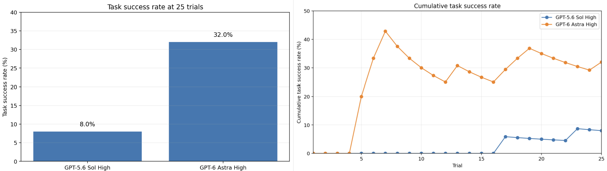
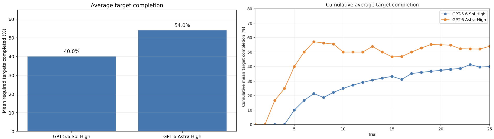

# Embedded Astra Comparison

A reproducible ROS 2 benchmark for comparing language models on iterative
robot manipulation using the **Code as Policies (CaP)** paradigm. A model writes
executable Python policy code to control a simulated Franka Emika Panda from a
single RGB camera and must move the two same-colored cubes into the blue tray
without moving the tray or placing either distractor in it.

Each model gets 25 attempts against the same reset scene. Between attempts it
may inspect the previous run's images, action log, and public grade, then revise
its Python policy. Gazebo Harmonic provides the simulation, MoveIt 2 plans arm
motions, and the evaluator records both public artifacts and private pose-based
grades.

The design combines CaP's executable policy-code interface with EmbodiedSWE's
iterative simulator feedback and outcome-based evaluation. It is an independent
comparison benchmark, not an exact reproduction of either paper.

## Setup

```bash
bash scripts/setup_environment.sh
source /opt/ros/jazzy/setup.bash
source install/setup.bash
```

Verify the complete stack before an evaluation:

```bash
bash scripts/run_evaluation.sh --check
```

> **GPU note:** the launch file currently selects
> `NVIDIA GeForce RTX 5080` for Mesa's WSLg D3D12 adapter. Change or remove the
> `MESA_D3D12_DEFAULT_ADAPTER_NAME` setting in
> `src/tabletop_sim/launch/tabletop_sim.launch.py` if that is not your GPU.

## Run an evaluation

Choose a filesystem-safe name for the model:

```bash
bash scripts/run_evaluation.sh --model MODEL_NAME
```

The runner manages the simulator and guides the human-in-the-loop model handoff:

1. It copies `prompts/system.txt`, `prompts/task.txt`, and
   `prompts/initial.png` into `results/MODEL_NAME/`.
2. Give that directory to the model as its entire workspace. The model must
   create `policy.py` defining `policy(robot) -> None`.
3. Return to the runner and press Enter. The policy executes against the reset
   scene for at most 120 seconds.
4. For attempts 2 through 25, have the same model inspect the preceding
   `attemptNNN/` directory and revise only the active `policy.py`, then press
   Enter again.

Do not expose `private/` to the evaluated model. That directory contains
privileged pose-based grades; the model is allowed to see only its workspace
under `results/`.

If an evaluation is interrupted, continue it with:

```bash
bash scripts/run_evaluation.sh --model MODEL_NAME --resume
```

Resume validates that completed public and private artifacts agree and reruns a
single incomplete trailing attempt when necessary. Starting without `--resume`
refuses to overwrite existing results.

## Policy interface

Policies receive a deliberately small, high-level robot API:

```python
def policy(robot) -> None:
    frame = robot.capture_camera()
    pose = robot.get_end_effector_pose()
    robot.open_gripper()
    robot.move_to((0.50, 0.10, 0.25))
    robot.move_relative(dz=-0.10)
    robot.close_gripper()
```

Available methods are:

- `capture_camera(timeout=5.0)` — fresh 640x480 RGB `CameraFrame`
- `get_end_effector_pose(timeout=5.0)` — fingertip-midpoint position and
  quaternion orientation
- `move_to(position, orientation=None)` — collision-checked Cartesian pose goal
- `move_relative(dx=0, dy=0, dz=0)` — motion relative to the current pose
- `open_gripper()` and `close_gripper()`

Coordinates are metres in a fixed world frame: +x points away from the robot,
+y points to its left, and +z points upward. The complete sandbox rules and API
contract supplied to models are in `prompts/system.txt`.

## Scoring and artifacts

A successful run must:

- keep the blue tray upright and within the configured position/orientation
  tolerance;
- place both repeated-color target cubes inside it; and
- keep both uniquely colored distractor cubes outside it.

Public policies, images, action logs, grades, aggregate statistics, and the best
attempt are stored under `results/MODEL_NAME/`; privileged pose-based grades are
stored separately under `private/MODEL_NAME/`. Both generated directories are
ignored by Git.

## Results

The figures below compare GPT-5.6 Sol High and GPT-6 Astra High over 25
sequential attempts each. Because the scene is reset identically before every
attempt while each model may revise its policy using feedback from the preceding
attempt, the cumulative curves describe adaptation within this benchmark rather
than performance on 25 independent tasks.

### Task success



**Figure 1. Final and cumulative task success.** GPT-6 Astra High succeeded on
8 of 25 attempts (32%), compared with 2 of 25 (8%) for GPT-5.6 Sol High. This is
a 24 percentage-point difference and a fourfold higher observed success rate.
Astra recorded its first success by attempt 5 and accumulated successes
throughout the run; Sol recorded its first success at attempt 17. The downward
segments in the cumulative curves do not mean that a previous success was lost:
they occur when a new unsuccessful attempt increases the denominator. In this
iterative setting, an unsuccessful attempt may happen when the model revises
its policy to try a different strategy based on feedback from the previous run.
These new strategies may be attempts to reduce task-completion time, even after
the model has already found a slower strategy that succeeds. Exploring a faster
approach can therefore produce a short-term dip in consistency.

### Target completion



**Figure 2. Final and cumulative target-cube completion.** Each attempt contains
two required target cubes, so the 25 attempts provide 50 possible target
placements per model. Astra completed 27 of 50 placements (54%), while Sol
completed 20 of 50 (40%): a 14 percentage-point, or 35% relative, improvement.
The cumulative curves show Astra gaining useful partial task performance much
earlier, while Sol improves more gradually and remains below Astra at the end
of the evaluation.

Taken together, the results show a larger gap in complete task success than in
target placement alone. This suggests that Astra was better at converting
partial manipulation progress into runs satisfying all criteria simultaneously
(both targets placed, no distractors in the tray, and a stable tray). Confirming
which constraint accounts for that gap would require the per-attempt criterion
data, which are not encoded in these aggregate figures.

These numbers are descriptive results for one fixed scene and one sequential
25-attempt run per model. They do not provide confidence intervals or establish
performance across different scenes, seeds, tasks, or repeated evaluation runs.

## References

1. J. Liang, W. Huang, F. Xia, P. Xu, K. Hausman, B. Ichter, P. Florence, and
   A. Zeng, “Code as Policies: Language Model Programs for Embodied Control,”
   *2023 IEEE International Conference on Robotics and Automation (ICRA)*,
   pp. 9493–9500, 2023. [Paper](https://arxiv.org/pdf/2209.07753) ·
   [DOI](https://doi.org/10.1109/ICRA48891.2023.10160591)
2. Z. Shen, H. You, Y. Liu, Z. Zheng, L. Zha, K. Yamazaki, M. Zhang, S. Huang,
   J. Sun, Q. Chen, L. He, K. Liu, H. Chang, K. Fragkiadaki, D. Shah,
   M. Schwager, P. Henderson, I. Abraham, and C. Xu, “EmbodiedSWE: Coding Agents
   for Long Horizon Dexterous Robotics,” arXiv:2609.27308, 2026.
   [Paper](https://embodiedswe.github.io/assets/paper/embodiedswe.pdf) ·
   [Project page](https://embodiedswe.github.io/)
